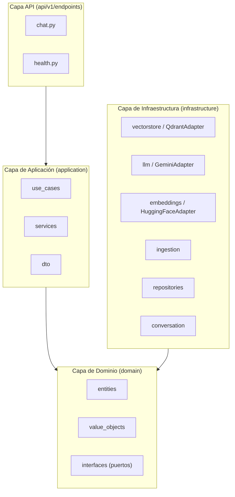
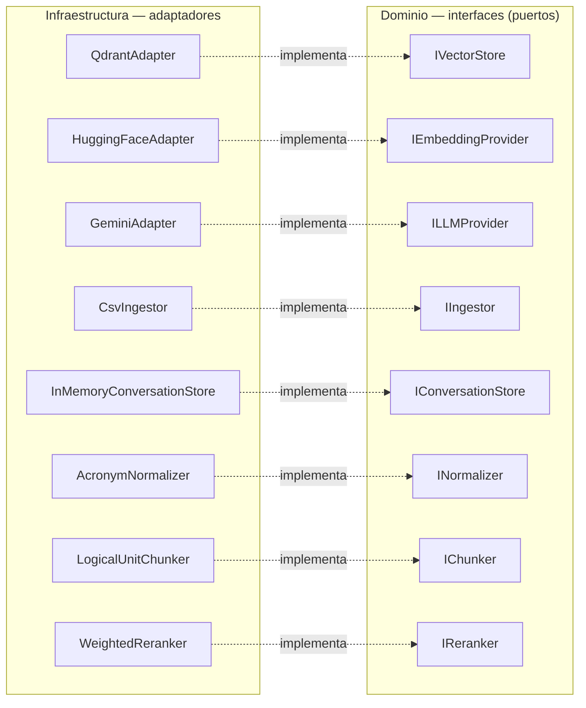
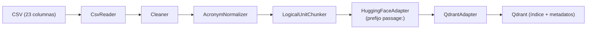
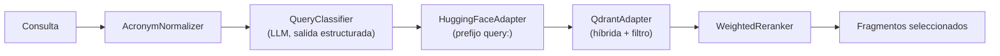
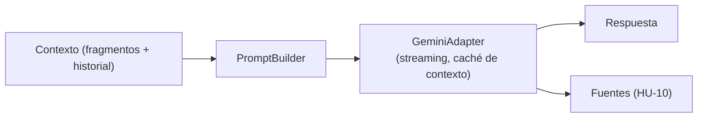
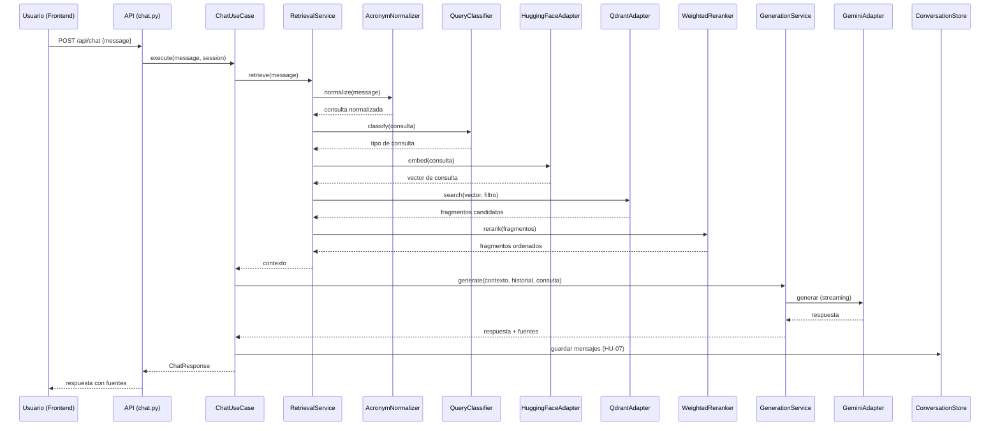
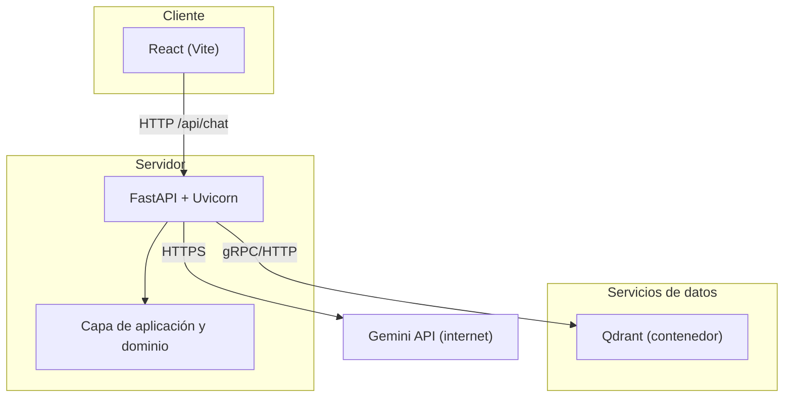

# Diseño Detallado de la Arquitectura Modular del Sistema

En el siguiente documento se presenta el diseño detallado de la arquitectura modular del sistema. Este diseño sintetiza las decisiones adoptadas en las etapas previas (selección de herramientas, infraestructura, requerimientos de recuperación, estrategia de segmentación y optimización) y las traduce en una estructura de módulos con responsabilidades definidas, interfaces explícitas y flujos de operación.

El diseño se organiza en tres partes: la estructura estática (capas, módulos e interfaces), los flujos dinámicos (preparación, recuperación y generación) y el despliegue.

## 1. Principios de Diseño

El diseño se rige por la arquitectura limpia y por los principios SOLID:

- **Separación en capas**: la capa de API depende de la aplicación, la aplicación depende del dominio, y la infraestructura implementa las interfaces del dominio.
- **Inversión de dependencias (DIP):** la lógica de negocio depende de abstracciones (puertos), nunca de implementaciones concretas. Esto permite sustituir la base vectorial, el modelo de lenguaje o el modelo de embeddings sin modificar los casos de uso.
- **Responsabilidad única:** cada módulo tiene una única responsabilidad y se comunica con los demás a través de interfaces.

## 2. Arquitectura por Capas

El sistema se organiza en cuatro capas: API, aplicación, dominio e infraestructura.

La regla de dependencia indica que `api -> application -> domain <- infrastructure`. La capa de dominio no importa de la infraestructura, la infraestructura implementa los puertos definidos en el dominio.

## 3. Módulos del Sistema

### 3.1 Capa de Dominio

| Módulo | Responsabilidad |
|---|---|
| `entities` | Modelos puros: `Researcher`, `Chunk`, `Message`, `Conversation`, `Source` |
| `value_objects` | Objetos inmutables con validación: `CvLACUrl`, `Section`, `QueryType` |
| `interfaces` | Puertos: `IVectorStore`, `IEmbeddingProvider`, `ILLMProvider`, `IIngestor`, `IConversationStore`, `INormalizer`, `IChunker`, `IReranker` |

### 3.2 Capa de Aplicación

| Módulo | Responsabilidad |
|---|---|
| `dto` | Contratos de entrada y salida: `ChatRequest`, `ChatResponse`, `Source`, `RetrievalResult` |
| `services` | Orquestación reutilizable: `RetrievalService`, `GenerationService` |
| `use_cases` | Casos de uso: `ChatUseCase` (HU-04/05), `SummarizeUseCase` (HU-08), `CiteSourcesUseCase` (HU-10) |

### 3.3 Capa de Infraestructura

| Módulo | Responsabilidad | Implementa |
|---|---|---|
| `vectorstore` | `QdrantAdapter`: búsqueda híbrida, filtrado por metadatos, indexación | `IVectorStore` |
| `llm` | `GeminiAdapter`: generación, clasificación, streaming, caché de contexto | `ILLMProvider` |
| `embeddings` | `HuggingFaceAdapter`: generación de embeddings con prefijos | `IEmbeddingProvider` |
| `ingestion` | `CsvReader`, `Cleaner`, `Chunker`, `Normalizer`, `Indexer` | `IIngestor`, `IChunker`, `INormalizer` |
| `repositories` | `CvLACRepository`: acceso a los datos de origen | — |
| `conversation` | `InMemoryConversationStore`: contexto por sesión | `IConversationStore` |

### 3.4 Capa de API

| Módulo | Responsabilidad |
|---|---|
| `chat.py` | Endpoint `POST /api/chat`: recibe la consulta, inyecta dependencias, invoca el caso de uso |
| `health.py` | Endpoint `GET /health`: verificación de disponibilidad |

## 4. Interfaces y Adaptadores (DIP)

La inversión de dependencias se materializa en el vínculo entre los puertos del dominio y sus adaptadores en la infraestructura.

## 5. Flujos del Sistema

### 5.1 Flujo de Preparación (Ingesta)

Transforma los archivos CSV en fragmentos indexados en la base vectorial.

Etapas:

1. **Lectura:** el `CsvReader` lee el archivo conforme al contrato de datos y produce una entidad `Researcher` por fila.
2. **Limpieza:** el `Cleaner` elimina caracteres de control y normaliza el texto.
3. **Normalización:** el `AcronymNormalizer` resuelve acrónimos mediante el mapeo basado en evidencia (HU-09).
4. **Segmentación:** el `LogicalUnitChunker` divide cada sección por unidad lógica, con límite de tamaño.
5. **Embeddings:** el `HuggingFaceAdapter` genera los vectores aplicando el prefijo `passage:`.
6. **Indexación:** el `QdrantAdapter` almacena los fragmentos con metadatos de autor, sección y enlace.

### 5.2 Flujo de Recuperación

Recupera los fragmentos más relevantes para una consulta.

Etapas:

1. **Normalización:** se resuelven acrónimos de la consulta (HU-09).
2. **Clasificación:** el `QueryClassifier` determina si la consulta es específica (un investigador) o general (temática), mediante salida estructurada (HU-04/05).
3. **Embedding:** se genera el vector de la consulta con el prefijo `query:`.
4. **Búsqueda:** el `QdrantAdapter` ejecuta la búsqueda híbrida, aplicando filtrado por metadatos cuando la consulta es específica.
5. **Re-ranking:** el `WeightedReranker` ordena los fragmentos por relevancia y prioridad de sección.

### 5.3 Flujo de Generación

Genera la respuesta a partir del contexto recuperado.

Etapas:

1. **Composición del prompt:** el `PromptBuilder` combina la instrucción de sistema, el contexto recuperado, el historial conversacional y la consulta.
2. **Generación:** el `GeminiAdapter` genera la respuesta de manera incremental, con caché del prefijo del sistema y reintentos con espera exponencial.
3. **Trazabilidad:** se extraen las fuentes empleadas para acompañar la respuesta (HU-10).

### 5.4 Flujo Completo (End-to-End)

## 6. Despliegue

El sistema se empaqueta con Docker Compose en tres servicios.

La separación en servicios (cliente, servidor y servicio vectorial) mantiene un acoplamiento bajo y permite incorporar, en etapas posteriores, la medición del comportamiento del sistema sobre la red.
